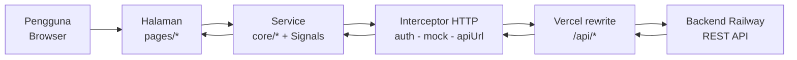
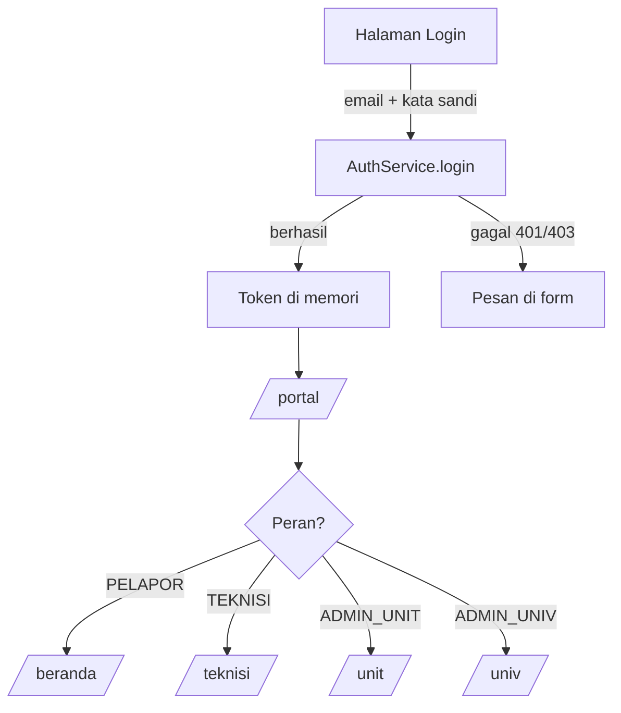
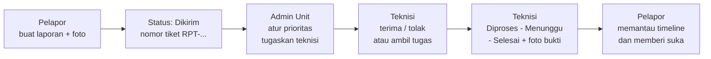

# README untuk PPT: Arsitektur Frontend I'M Care UII (UII SIRA)

> **Petunjuk untuk AI pembuat PPT:** ubah dokumen ini menjadi **tepat 3 slide**. Satu bagian `## SLIDE` = satu slide. Pakai judul slide, poin isi, tabel, dan diagram persis seperti tertulis di sini. Jangan menambah klaim yang tidak ada di dokumen. Teks dalam `> Catatan pembicara` dimasukkan ke notes slide, bukan ke badan slide. Bahasa: Indonesia. Gaya visual: biru UII (`#0867d8`), aksen kuning (`#f6d106`), font Poppins, latar putih.
>
> Semua angka di dokumen ini diambil dari kode dan build yang sebenarnya. Bagian yang belum tercapai sengaja ditulis jujur, jangan dihapus.

**Proyek:** Aplikasi web pelaporan fasilitas rusak UII (I'M Care UII / UII SIRA), tim BSI UII, MVP 18-23 November 2026.
**Peran saya:** Frontend developer.

---

## SLIDE 1: Teknologi yang Dipakai

**Judul slide:** Teknologi dan Arsitektur Frontend
**Subjudul:** Angular 22 · TypeScript · Signals · CSS murni · Vercel + Railway

### 1.1 Tumpukan teknologi (buat sebagai tabel atau kartu berkelompok)

| Lapisan | Teknologi | Versi | Dipakai untuk |
|---|---|---|---|
| Framework | **Angular** (komponen standalone) | 22.3 | Seluruh antarmuka, routing, form, HTTP |
| Bahasa | **TypeScript** (mode strict) | 6.0 | Seluruh kode, tipe data laporan dan peran |
| State | **Angular Signals** (`signal`, `computed`, `effect`) | bawaan Angular | Data bersama di service, tanpa pustaka state tambahan |
| Async | **RxJS** | 7.8 | Aliran route dan HTTP (dipakai seperlunya, `firstValueFrom` untuk panggilan API) |
| Form | **Reactive Forms** | bawaan Angular | Login, daftar, buat laporan, form gedung, form akun |
| Routing | **Angular Router** | bawaan Angular | Lazy loading per halaman, guard login dan peran, preloading |
| HTTP | **HttpClient + interceptor fungsional** | bawaan Angular | Token login, alamat API, mode demo |
| Gaya | **CSS murni + design token** (variabel `--nama`) | - | Tanpa Tailwind dan tanpa pustaka UI; satu berkas `styles.css` untuk token, komponen kecil di tiap komponen |
| Font | **Poppins** (Google Fonts, dimuat tanpa memblokir render) | - | Semua teks, sesuai guideline desain |
| Build | **Angular CLI** (`@angular/build`, esbuild) | 22.3 | Build produksi, dev server dengan proxy |
| Hosting frontend | **Vercel** | - | `ng build` produksi, penulisan ulang URL (rewrite) |
| Backend (milik tim backend) | **Railway** (REST API `/api/...`) | - | Data, autentikasi, penyimpanan foto |

**Yang sengaja tidak dipakai:** Tailwind (dihapus), pustaka komponen UI, NgRx atau pustaka state lain, penyimpanan token di localStorage (token hanya di memori, aturan keamanan tim).

### 1.2 Struktur kode (buat sebagai diagram pohon atau empat blok)

```
src/app/
  core/     Logika dan data, TANPA tampilan
            auth (service, guard, interceptor) · reports · tech · admin · http · mock · ui
  shared/   Komponen tampilan yang dipakai ulang (11)
            dialog · unlike-dialog · result-dialog · toast · report-table · page-head
            icon · insight · skeleton · status-badge · welcome
  pages/    Halaman, satu folder per peran
            public · warga (pelapor) · teknisi · unit (Admin Unit) · univ (Admin Universitas)
  layout/   Kerangka: shell (menu per peran) dan header
```

### 1.3 Keputusan arsitektur penting (3-5 poin ringkas)

1. **Satu service per domain, komponen tidak menyimpan data sendiri.** `ReportService`, `TechService`, `AdminService`, `AuthService` memegang data lewat signal; halaman hanya menampilkan.
2. **Lazy loading + preloading.** Semua halaman diunduh saat dibuka (`loadComponent`), lalu `PreloadAllModules` mengunduh sisanya di latar. Bundel awal **349,81 kB mentah / 95,60 kB terkirim**.
3. **Satu kode untuk empat peran.** Menu, beranda, dan penjaga akses ditentukan oleh peran (`ROLE_HOME`, `roleGuard`), bukan membuat aplikasi terpisah per peran.
4. **Komponen bersama untuk pola yang berulang:** pop-up konfirmasi, kartu hasil aksi, notifikasi, tabel laporan, kerangka pemuatan.
5. **Mode demo (`mock-api`).** Backend palsu di dalam browser membuat seluruh alur bisa diperagakan tanpa server; dimatikan dengan satu bendera `DEMO = false`.

### 1.4 Angka ringkas (kartu angka besar di sisi slide)

| Angka | Arti |
|---|---|
| **4** | peran pengguna (Pelapor, Teknisi, Admin Unit, Admin Universitas) |
| **26** | halaman yang dimuat malas (lazy loading) |
| **58** | berkas TypeScript, sekitar **5.700** baris |
| **11** | komponen tampilan bersama |
| **19** | endpoint backend yang dipanggil |
| **95,6 kB** | ukuran bundel awal terkirim |

> **Catatan pembicara (slide 1):** Pilihan Angular 22 dengan komponen standalone dan Signals membuat kode ringkas dan tanpa pustaka state tambahan. Styling sengaja CSS murni dengan token warna di satu tempat agar mudah mengikuti guideline UII dan konsisten antar halaman. Token login hanya disimpan di memori, jadi refresh halaman meminta login ulang; itu disengaja demi keamanan.

---

## SLIDE 2: Flow Aplikasi

**Judul slide:** Alur Kerja Aplikasi dan Aliran Data
**Subjudul:** Dari login, per peran, sampai laporan selesai

### 2.1 Flow lapisan teknis (gambar sebagai diagram alur horizontal, 6 kotak)



Penjelasan tiap kotak (tampilkan sebagai keterangan di bawah diagram):

| Kotak | Tugas |
|---|---|
| Halaman | Menampilkan data dari signal, menangkap aksi pengguna |
| Service | Memanggil API, menyimpan hasil di signal, memetakan data backend ke bentuk tampilan |
| Interceptor | `authInterceptor` menempel token dan menangani 401, `mockInterceptor` (mode demo), `apiUrlInterceptor` menambah alamat API |
| Vercel rewrite | Meneruskan `/api/*` ke Railway sehingga browser hanya bicara ke satu alamat (tanpa CORS) |
| Backend | Aturan bisnis dan hak akses sebenarnya; frontend hanya kenyamanan |

### 2.2 Flow pengguna: masuk dan penjagaan akses (diagram vertikal)



Penjaga akses (tampilkan sebagai tiga ikon gembok bertulisan):
- `authGuard`: belum login -> `/login`
- `guestGuard`: sudah login membuka login/daftar -> `/portal`
- `roleGuard`: halaman peran lain -> dialihkan ke beranda perannya sendiri

### 2.3 Flow bisnis: siklus laporan (diagram swimlane atau 5 langkah berwarna)



| Peran | Yang dikerjakan di aplikasi |
|---|---|
| **Pelapor** | Buat laporan (foto dikompres sebelum dikirim), pantau status, suka laporan publik, hapus laporan berstatus Dikirim |
| **Teknisi** | Lihat daftar tugas (Semua, Tersedia, Tugas Saya), ambil tugas, terima atau tolak penugasan, ubah status dengan foto bukti |
| **Admin Unit (Kaur)** | Kelola laporan, atur prioritas, tugaskan teknisi, lihat dashboard dan statistik per bulan |
| **Admin Universitas** | Kelola gedung dan akun pengguna (tambah, ubah, nonaktifkan) |

### 2.4 Pola interaksi yang seragam (4 ikon kecil)

1. **Memuat, kosong, gagal:** setiap data punya kerangka pemuatan, pesan kosong, dan pesan gagal.
2. **Cari dulu, baru muat:** semua filter daftar menunggu tombol **Cari** (atau Enter), bukan berubah tiap ketikan.
3. **Konfirmasi lalu kartu hasil:** aksi penting (hapus, keluar, batal suka) minta konfirmasi; aksi ke server (tugaskan teknisi, ubah status) menampilkan kartu hasil berisi pesan backend dan kode HTTP.
4. **Data segar:** daftar laporan publik diperbarui tiap 10 detik dan data Admin Unit tiap 15 detik selama tab terlihat.

> **Catatan pembicara (slide 2):** Alur data satu arah: halaman memanggil service, service memanggil API lewat interceptor, hasilnya masuk ke signal, tampilan ikut berubah otomatis. Hak akses sebenarnya tetap di backend; guard di frontend hanya mengarahkan pengguna agar tidak melihat halaman yang bukan miliknya.

---

## SLIDE 3: Output dan Ketercapaian

**Judul slide:** Hasil Kerja dan Ketercapaian Frontend
**Subjudul:** 16 dari 25 user story tercapai penuh di frontend, 2 sebagian

### 3.1 Output yang dihasilkan (daftar kartu per peran)

| Peran | Halaman yang selesai | Jumlah |
|---|---|---|
| Publik | Landing, Masuk, Daftar, Lupa kata sandi, Portal | 5 |
| Pelapor | Beranda, Buat laporan, Preview foto, Laporan terkirim, Detail laporan, Laporan Saya dan Laporan publik | 6 |
| Teknisi | Dashboard dan daftar tugas, Detail tugas, Pembaruan status, Tolak penugasan, Penugasan dikembalikan | 5 |
| Admin Unit | Dashboard, Kelola laporan, Detail laporan, Tugaskan teknisi, Statistik | 5 |
| Admin Universitas | Dashboard, Kelola gedung, Form gedung, Kelola akun, Form akun | 5 |

Hasil teknis lain: **11 komponen bersama**, **4 service data**, **3 interceptor**, **3 jenis guard**, tampilan **responsif** (desktop dan HP, menu bawah di HP), build produksi lolos.

### 3.2 Ketercapaian terhadap 25 user story (buat sebagai tabel berwarna atau diagram donat)

| Status | Jumlah | User story |
|---|---|---|
| ✅ Tercapai di frontend | **16** | US-01 Masuk/daftar · US-02 Menu sesuai peran · US-03 Buat laporan · US-04 Nomor tiket · US-05 Pantau status · US-07 Suka laporan publik · US-09 Daftar tugas · US-10 Ambil tugas · US-11 Terima/tolak tugas · US-12 Ubah status · US-13 Foto bukti · US-14 Tugaskan teknisi · US-15 Prioritas Urgen · US-18 Dashboard laporan · US-20 Kelola gedung · US-21 Kelola akun |
| 🟡 Sebagian | **2** | US-06 Notifikasi (hanya notifikasi di dalam aplikasi; email menunggu backend) · US-08 Edit/hapus (hapus sudah ada, edit menunggu backend) |
| ❌ Belum | **7** | US-16 Tandai kerusakan besar · US-17 Pindah gedung · US-19 Ekspor data · US-22 Dashboard seluruh gedung (baru pintasan) · US-23 QR aset · US-24 Rating · US-25 Riwayat per aset |

Berdasarkan prioritas: **Must 11 dari 13 tercapai penuh, 2 sebagian**; **Should 5 dari 9**; **Could 0 dari 3** (memang belum masuk MVP).

### 3.3 Peningkatan kualitas yang dikerjakan (kartu "sebelum -> sesudah")

| Area | Sebelum | Sesudah |
|---|---|---|
| Kecepatan login | Login menunggu semua halaman laporan dimuat; LCP terukur **5,66 s** (kategori buruk) | Pindah ke portal langsung, data dimuat di latar, font tidak memblokir, preloading chunk |
| Sesi dan peran | Tombol Kembali membuka login saat masih masuk; admin bisa membuka halaman pelapor; logo selalu ke beranda pelapor | `guestGuard`, `roleGuard`, logo menuju beranda sesuai peran |
| Bug penugasan | Klik "Konfirmasi penugasan" memuat ulang halaman dan keluar ke login | Form diperbaiki, hasil tampil di kartu hasil dengan kode HTTP |
| Konsistensi data Admin Unit | Angka tidak sesuai sisi pelapor; data hanya dimuat sekali | Penyegaran otomatis, "Semua bulan", pengelompokan tanggal lokal, hitungan suka disamakan |
| Filter | Daftar berubah tiap ketikan | Tombol Cari, filter suka (3 pilihan), filter kembali kosong saat pindah tab atau halaman |
| Umpan balik pengguna | Aksi berhasil/gagal tanpa kejelasan | Pop-up konfirmasi, kartu hasil, notifikasi pojok kanan atas |
| Fitur akun | Tanpa lupa kata sandi | Lupa kata sandi lewat Admin Universitas, ikon lihat kata sandi, konfirmasi keluar |

### 3.4 Catatan jujur dan rencana lanjutan (dua kolom)

| Belum selesai atau perlu dikonfirmasi | Rencana lanjutan |
|---|---|
| Belum ada tes otomatis (0 berkas tes); verifikasi masih manual | Tulis tes unit (validator, guard, pemetaan status) dan E2E alur utama |
| LCP setelah perbaikan **belum diukur ulang** | Ukur ulang dengan Lighthouse pada build produksi |
| Endpoint hapus laporan dan format respons kartu hasil **ditebak** mengikuti pola API, belum dikonfirmasi backend | Konfirmasi kontrak API dengan tim backend |
| Edit laporan dan reset kata sandi lewat email menunggu endpoint backend | Aktifkan setelah backend siap |
| Dashboard Admin Universitas, ekspor data, pindah gedung belum ada | Prioritaskan fitur Should berikutnya |

> **Catatan pembicara (slide 3):** Tekankan bahwa seluruh alur utama sudah berjalan end-to-end di frontend untuk empat peran, dan semua yang bergantung pada backend sudah ditandai jelas. Angka ketercapaian dihitung dari 25 user story pada dokumen User Stories dan Acceptance Criteria. Poin sebelum-sesudah berasal dari perbaikan bug dan peningkatan yang dikerjakan selama pengembangan.

---

## Lampiran A: Daftar endpoint backend yang dipanggil frontend (untuk slide 1 atau 2 jika perlu)

`POST /api/auth/login` · `POST /api/auth/register` · `POST /api/auth/logout` · `GET /api/locations` · `GET /api/damage-categories` · `GET /api/reports` · `GET /api/reports/public` · `GET /api/reports/my-reports` · `GET /api/reports/detail` · `POST /api/reports` · `POST /api/reports/like` · `GET /api/reports/tasks` · `GET /api/reports/technicians` · `POST /api/reports/assign` · `POST /api/reports/priority` · `POST /api/reports/self-assign` · `POST /api/reports/respond-assignment` · `POST /api/reports/status` · `GET|POST|PUT /api/admin/users` · `POST /api/admin/users/toggle-status` · `POST|PUT|DELETE /api/locations`

## Lampiran B: Saran tata letak slide

| Slide | Tata letak |
|---|---|
| 1 | Kiri: tabel tumpukan teknologi. Kanan atas: diagram struktur folder. Kanan bawah: enam kartu angka |
| 2 | Atas: diagram flow teknis horizontal. Bawah kiri: flow login per peran. Bawah kanan: siklus laporan. Strip bawah: empat pola interaksi |
| 3 | Kiri: kartu output per peran. Tengah: donat ketercapaian 16/2/7. Kanan: tabel sebelum-sesudah. Strip bawah: catatan jujur dan rencana |
